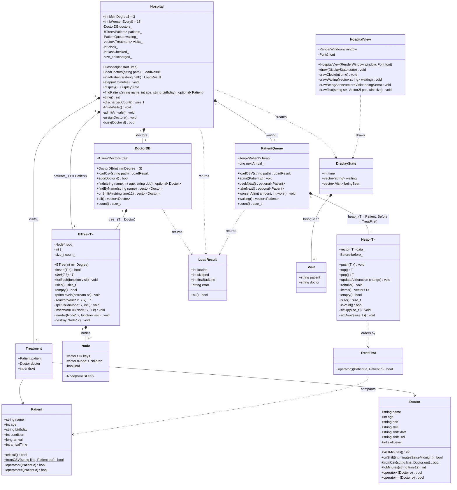

# UML Class Diagram — Nota Hospital Simulation

## How to read it

| Arrow | Meaning |
|---|---|
| `*--` (filled diamond) | Composition: the class owns the other and it lives inside it |
| `-->` | Association: holds a copy of / refers to |
| `..>` (dashed) | Dependency: uses, creates or returns |
| `+` / `-` | public / private |
| underlined (`$`) | static |

`BTree<T>` is one template used twice: `BTree<Patient>` inside `Hospital` and
`BTree<Doctor>` inside `DoctorDB`, both with minimum degree t = 3. `Heap<T, Before>`
is used as `Heap<Patient, TreatFirst>`, so the most urgent patient is always on top.
`main()` creates one `Hospital` and one `HospitalView`, calls `Hospital::step(5)` on
each Space press and draws `Hospital::display()` every frame.
